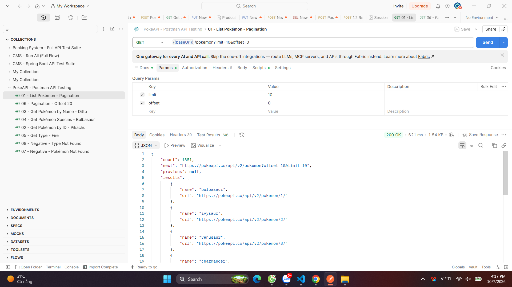
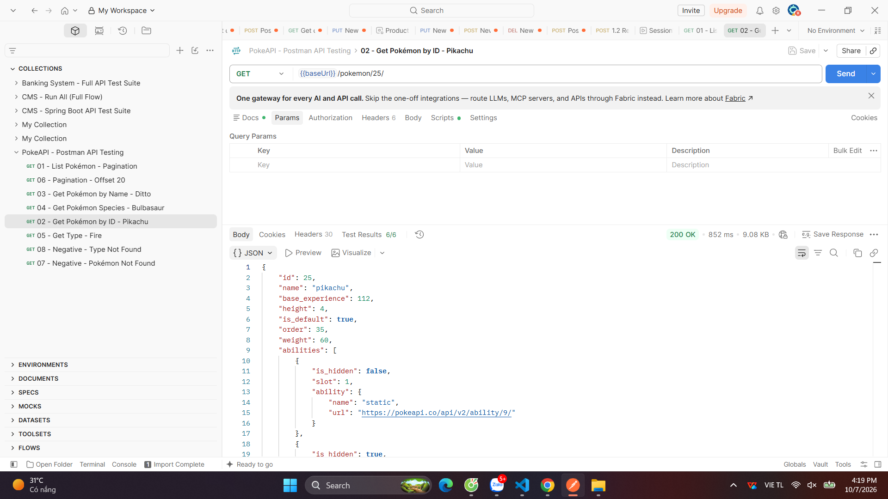
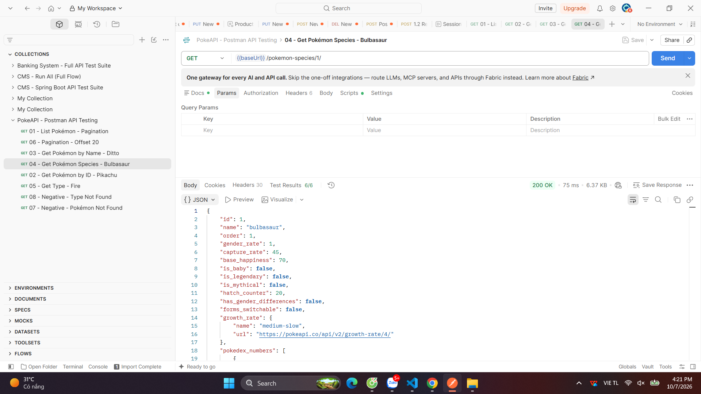
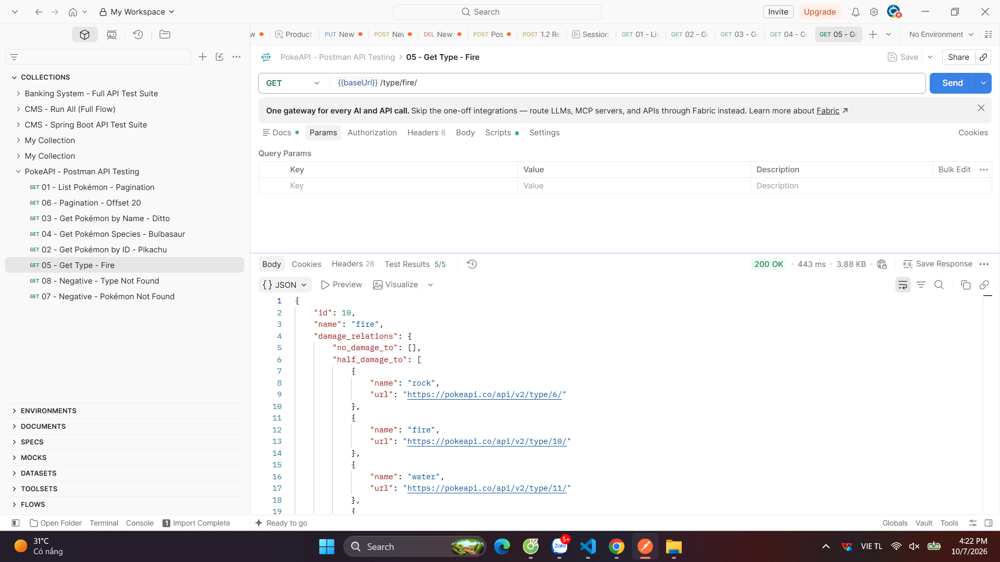
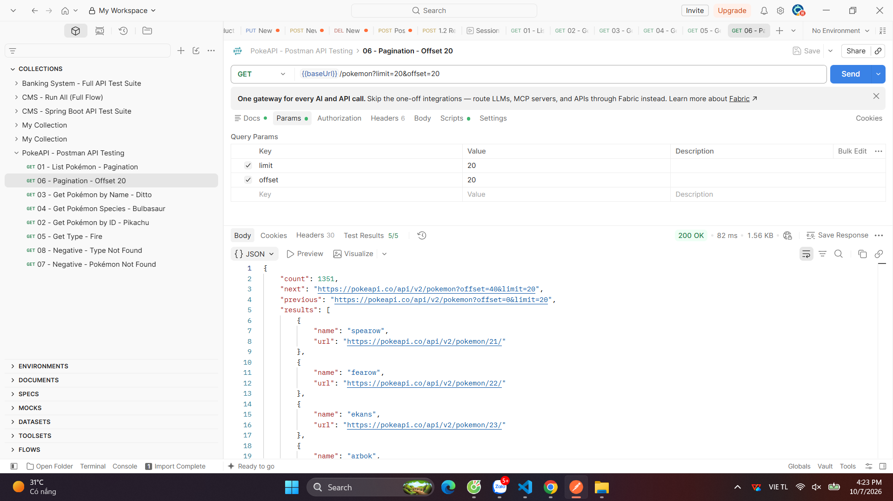
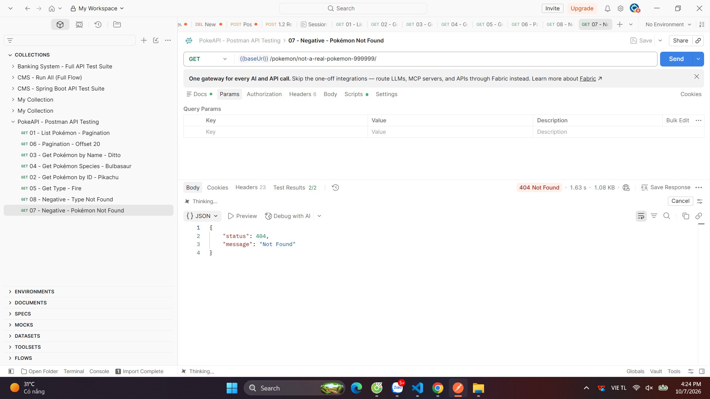
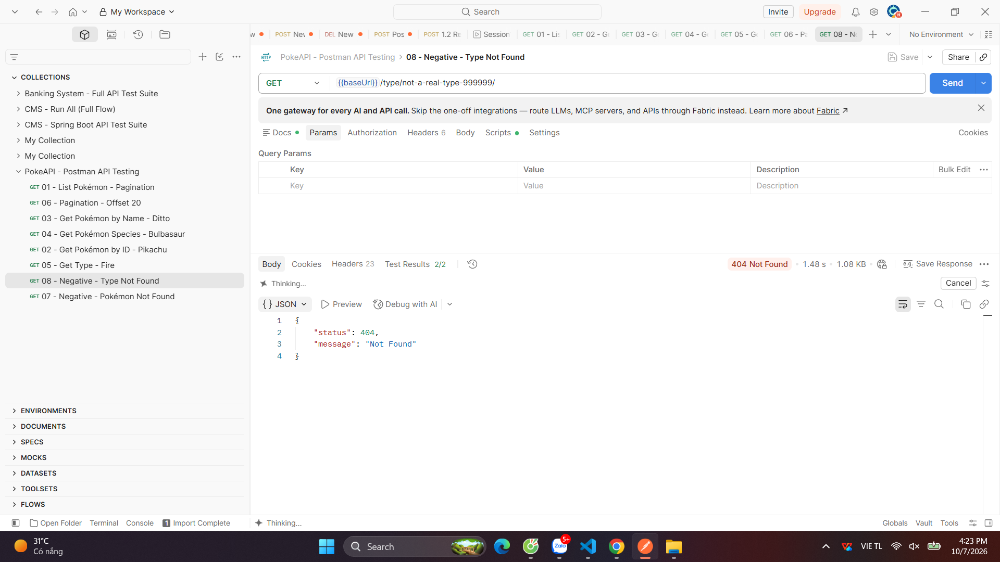

# PokeAPI - Kiểm thử API bằng Postman

## 1. Thông tin bài thực hành

| Nội dung | Thông tin |
|---|---|
| **Đề tài** | Kiểm thử API PokeAPI bằng Postman |
| **API** | [PokéAPI](https://pokeapi.co/) |
| **Tài liệu API** | [PokéAPI Documentation](https://pokeapi.co/docs/v2) |
| **Công cụ kiểm thử** | Postman |
| **Phương thức chính** | GET |
| **Authentication** | Không yêu cầu |
| **Response** | JSON |
| **Repository** | `pokeapi-postman-testing` |

### Mục tiêu

Bài thực hành nhằm làm quen với công cụ **Postman** và quy trình kiểm thử REST API thông qua:

- Tạo và gửi HTTP Request.
- Kiểm tra HTTP Status Code.
- Kiểm tra cấu trúc và dữ liệu JSON.
- Viết Test Script bằng JavaScript trong Postman.
- Kiểm thử trường hợp thành công và thất bại.
- Kiểm tra chức năng phân trang của API.
- Chạy nhiều test case bằng Collection Runner.

---

## 2. Môi trường kiểm thử

- **Client:** Postman
- **Base URL:** `https://pokeapi.co/api/v2`
- **HTTP Method:** `GET`
- **Response Format:** JSON
- **Authentication:** Không sử dụng

PokéAPI là API read-only, do đó các request trong bài thực hành chủ yếu sử dụng phương thức `GET`.

Các endpoint dạng danh sách hỗ trợ phân trang thông qua hai query parameter:

```text
limit
offset
```

---

## 3. Cấu trúc Repository

```text
pokeapi-postman-testing/
│
├── README.md
│
├── postman/
│   └── PokeAPI_Test_Collection.json
│
└── screenshots/
    ├── tc01-list-pokemon.png
    ├── tc02-pikachu.png
    ├── tc03-ditto.png
    ├── tc04-bulbasaur-species.png
    ├── tc05-fire-type.png
    ├── tc06-pagination.png
    ├── tc07-not-found-pokemon.png
    └── tc08-not-found-type.png
```

### Ý nghĩa các thư mục

**`postman/`**

Chứa Postman Collection được sử dụng để thực hiện toàn bộ các test case.

**`screenshots/`**

Chứa ảnh chụp màn hình kết quả thực tế sau khi gửi request và chạy test trong Postman.

---

# 4. Danh sách Test Case

| ID | Nội dung kiểm thử | Method | Endpoint | Expected Result |
|---|---|---|---|---|
| **TC01** | Lấy danh sách Pokémon | GET | `/pokemon?limit=10&offset=0` | `200`, có `count`, `next`, `previous`, `results`; `results` có 10 phần tử |
| **TC02** | Lấy Pokémon theo ID | GET | `/pokemon/25/` | `200`, `id = 25`, `name = pikachu` |
| **TC03** | Lấy Pokémon theo tên | GET | `/pokemon/ditto/` | `200`, `name = ditto` |
| **TC04** | Lấy thông tin Pokémon Species | GET | `/pokemon-species/1/` | `200`, `id = 1`, `name = bulbasaur` |
| **TC05** | Lấy thông tin Type | GET | `/type/fire/` | `200`, `name = fire`, có `damage_relations`, `pokemon` |
| **TC06** | Kiểm tra phân trang | GET | `/pokemon?limit=20&offset=20` | `200`, tối đa 20 phần tử, `next/previous` hợp lệ |
| **TC07** | Pokémon không tồn tại | GET | `/pokemon/not-a-real-pokemon-999999/` | `404` |
| **TC08** | Type không tồn tại | GET | `/type/not-a-real-type-999999/` | `404` |

---

# 5. Chi tiết kiểm thử

## TC01 - Lấy danh sách Pokémon

### Request

```http
GET https://pokeapi.co/api/v2/pokemon?limit=10&offset=0
```

### Nội dung kiểm tra

- HTTP Status Code = `200`
- Response trả về JSON.
- `count` có kiểu dữ liệu `number`.
- `results` có kiểu dữ liệu `array`.
- `results` có đúng 10 phần tử.
- Mỗi phần tử trong `results` có:
  - `name`
  - `url`

### Kết quả

**Ảnh minh họa:**



---

## TC02 - Lấy Pokémon theo ID

### Request

```http
GET https://pokeapi.co/api/v2/pokemon/25/
```

### Nội dung kiểm tra

- HTTP Status Code = `200`
- `id = 25`
- `name = "pikachu"`
- Response có trường `types`.
- Response có trường `sprites`.

### Kết quả



---

## TC03 - Lấy Pokémon theo tên

### Request

```http
GET https://pokeapi.co/api/v2/pokemon/ditto/
```

### Nội dung kiểm tra

- HTTP Status Code = `200`
- `name = "ditto"`
- `id` là số dương.
- `abilities` có kiểu dữ liệu `array`.

### Kết quả


---

## TC04 - Lấy thông tin Pokémon Species

### Request

```http
GET https://pokeapi.co/api/v2/pokemon-species/1/
```

### Nội dung kiểm tra

- HTTP Status Code = `200`
- `id = 1`
- `name = "bulbasaur"`
- `is_legendary` là kiểu `boolean`.
- `is_mythical` là kiểu `boolean`.

### Kết quả



---

## TC05 - Lấy thông tin Type

### Request

```http
GET https://pokeapi.co/api/v2/type/fire/
```

### Nội dung kiểm tra

- HTTP Status Code = `200`
- `name = "fire"`
- Có object `damage_relations`.
- Có array `pokemon`.

### Kết quả



---

## TC06 - Kiểm tra phân trang

### Request

```http
GET https://pokeapi.co/api/v2/pokemon?limit=20&offset=20
```

### Nội dung kiểm tra

- HTTP Status Code = `200`
- `results.length <= 20`
- `next` là `string` hoặc `null`.
- `previous` là `string` hoặc `null`.
- Dữ liệu trang thứ hai khác với trang đầu tiên.

### Kết quả



---

## TC07 - Pokémon không tồn tại

### Request

```http
GET https://pokeapi.co/api/v2/pokemon/not-a-real-pokemon-999999/
```

### Nội dung kiểm tra

- HTTP Status Code = `404`
- Response trả về JSON.

### Kết quả



---

## TC08 - Type không tồn tại

### Request

```http
GET https://pokeapi.co/api/v2/type/not-a-real-type-999999/
```

### Nội dung kiểm tra

- HTTP Status Code = `404`
- Response trả về JSON.

### Kết quả



---

# 6. Postman Test Script

Các request được kiểm tra bằng **Tests** trong Postman.

Ví dụ kiểm tra status code:

```javascript
pm.test("Status code is 200", function () {
    pm.response.to.have.status(200);
});
```

Ví dụ kiểm tra dữ liệu Pokémon:

```javascript
pm.test("Pokemon is Pikachu", function () {
    const jsonData = pm.response.json();

    pm.expect(jsonData.id).to.eql(25);
    pm.expect(jsonData.name).to.eql("pikachu");
});
```

Ví dụ kiểm tra danh sách Pokémon:

```javascript
pm.test("Results has 10 items", function () {
    const jsonData = pm.response.json();

    pm.expect(jsonData.results).to.be.an("array");
    pm.expect(jsonData.results.length).to.eql(10);
});
```

Ví dụ kiểm tra trường hợp không tìm thấy:

```javascript
pm.test("Status code is 404", function () {
    pm.response.to.have.status(404);
});
```

---

# 7. Cách import Collection vào Postman

### Bước 1

Mở **Postman**.

### Bước 2

Chọn:

```text
Import
```

### Bước 3

Chọn file:

```text
postman/PokeAPI_Test_Collection.json
```

### Bước 4

Sau khi import, Collection:

```text
PokeAPI - Postman API Testing
```

sẽ xuất hiện trong Postman.

### Bước 5

Mở từng request và chọn:

```text
Send
```

### Bước 6

Kiểm tra:

- HTTP Status Code.
- Response Body.
- Test Results.

---

# 8. Chạy toàn bộ Test Case

Trong Postman:

```text
Collection
    ↓
Run collection
    ↓
Chọn tất cả request
    ↓
Run
```

Sau khi chạy, Postman sẽ hiển thị kết quả của toàn bộ test case.

Có thể sử dụng màn hình **Test Results** để kiểm tra:

- Tổng số test.
- Số test Passed.
- Số test Failed.
- Test nào xảy ra lỗi.

---

# 9. Kết quả kiểm thử

Sau khi thực hiện kiểm thử, kết quả được tổng hợp như sau:

| Tổng Test | Passed | Failed | Pass Rate |
|---:|---:|---:|---:|
| 8 | ___ | ___ | ___% |

### Nhận xét

Qua quá trình kiểm thử, các endpoint của PokéAPI được kiểm tra với cả dữ liệu hợp lệ và không hợp lệ.

Các trường hợp thành công trả về HTTP `200` và dữ liệu JSON đáp ứng các điều kiện đã xây dựng trong test script.

Các trường hợp tài nguyên không tồn tại được kiểm tra với HTTP `404`, đúng với expected result.

Bên cạnh đó, chức năng phân trang của endpoint `/pokemon` cũng được kiểm tra thông qua hai tham số `limit` và `offset`.

---

# 10. Những kiến thức đạt được

Sau bài thực hành, các kiến thức và kỹ năng đạt được gồm:

- Làm quen với giao diện và các chức năng cơ bản của Postman.
- Tạo HTTP Request bằng phương thức `GET`.
- Thiết lập URL và Query Parameters.
- Gửi request đến REST API.
- Kiểm tra HTTP Status Code.
- Kiểm tra Response Body dạng JSON.
- Viết Test Script bằng JavaScript.
- Kiểm thử dữ liệu hợp lệ và không hợp lệ.
- Kiểm thử API Pagination.
- Sử dụng Collection Runner để chạy nhiều test case.
- Tổ chức test case và lưu trữ kết quả trên GitHub.

---

# 11. Hướng dẫn chạy bài

### Yêu cầu

- Đã cài đặt [Postman](https://www.postman.com/downloads/).
- Có Internet để truy cập PokéAPI.
- Clone repository về máy.

```bash
git clone <repository-url>
cd pokeapi-postman-testing
```

### Import Collection

Import file:

```text
postman/PokeAPI_Test_Collection.json
```

Sau đó chạy từng request hoặc sử dụng **Run Collection** để chạy toàn bộ test.

---

# 12. Tài liệu tham khảo

1. **PokéAPI**

   https://pokeapi.co/

2. **PokéAPI Documentation**

   https://pokeapi.co/docs/v2

3. **Postman Documentation**

   https://learning.postman.com/docs/

4. **Video hướng dẫn do giảng viên cung cấp**

   https://www.youtube.com/watch?v=MFxk5BZulVU

Ngoài các tài liệu trên, trong quá trình thực hiện có thể tham khảo thêm tài liệu Postman và API Testing phù hợp để hiểu rõ hơn về cách xây dựng test case và test script.

---

